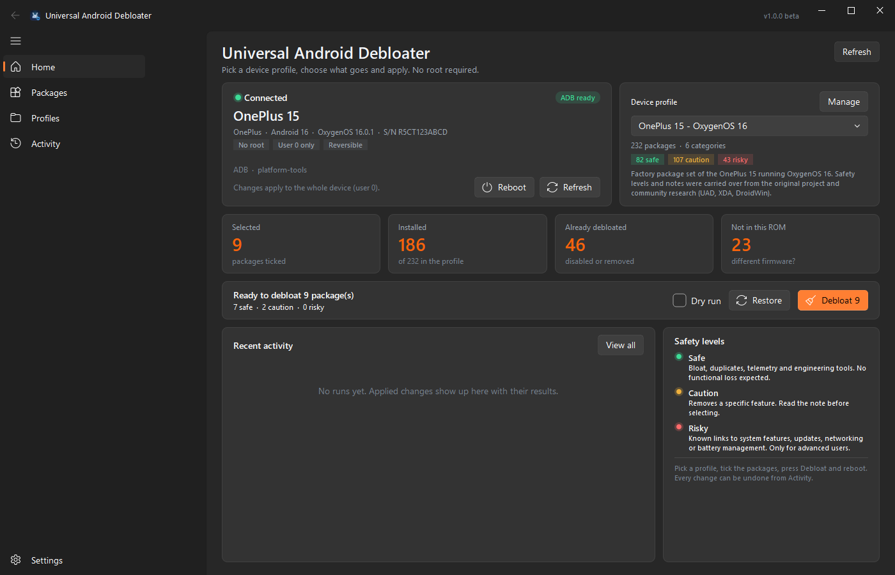
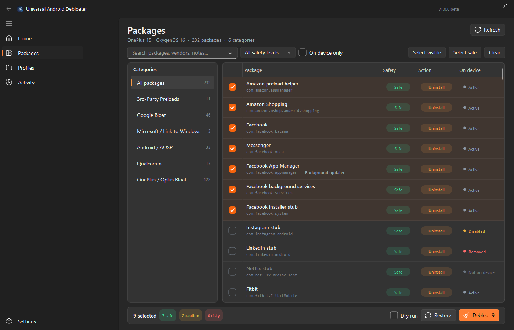
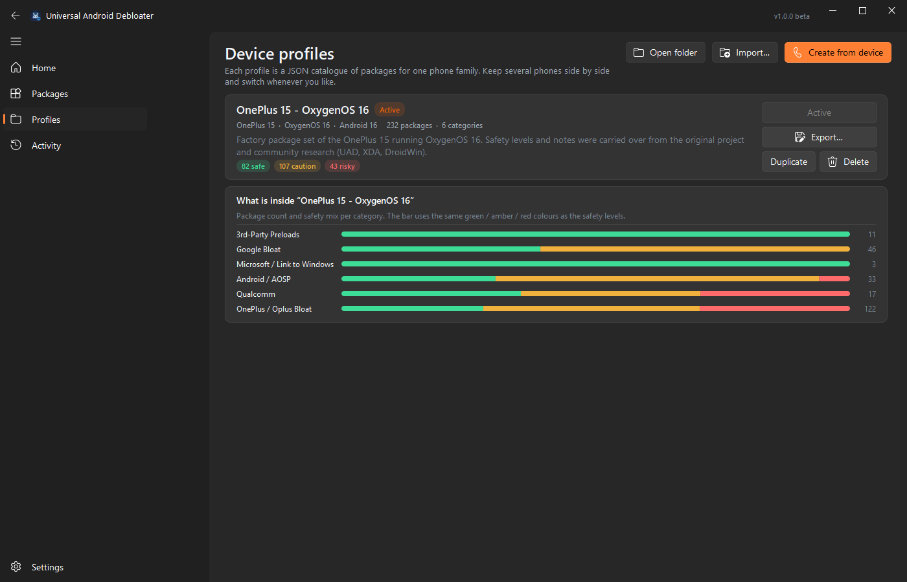
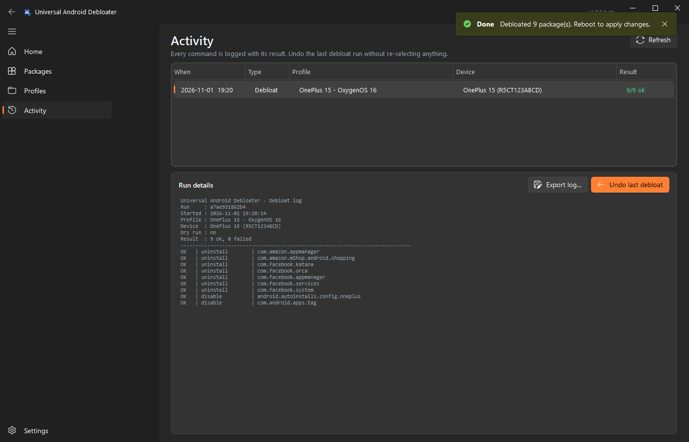
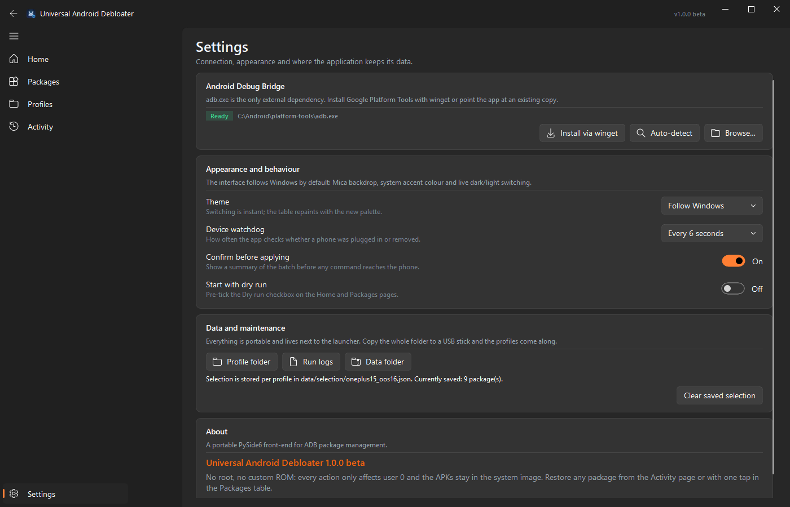
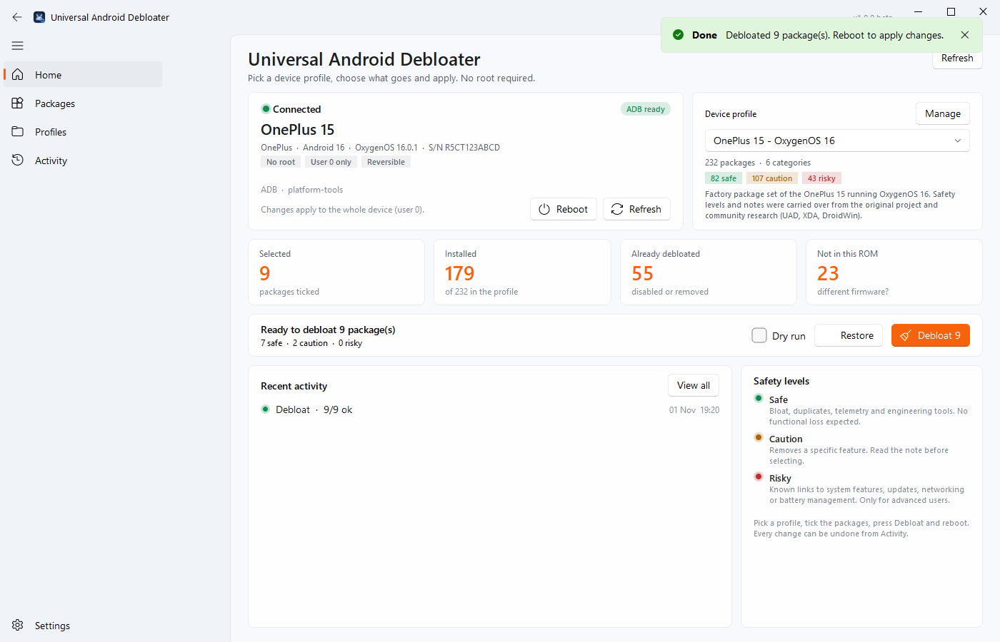
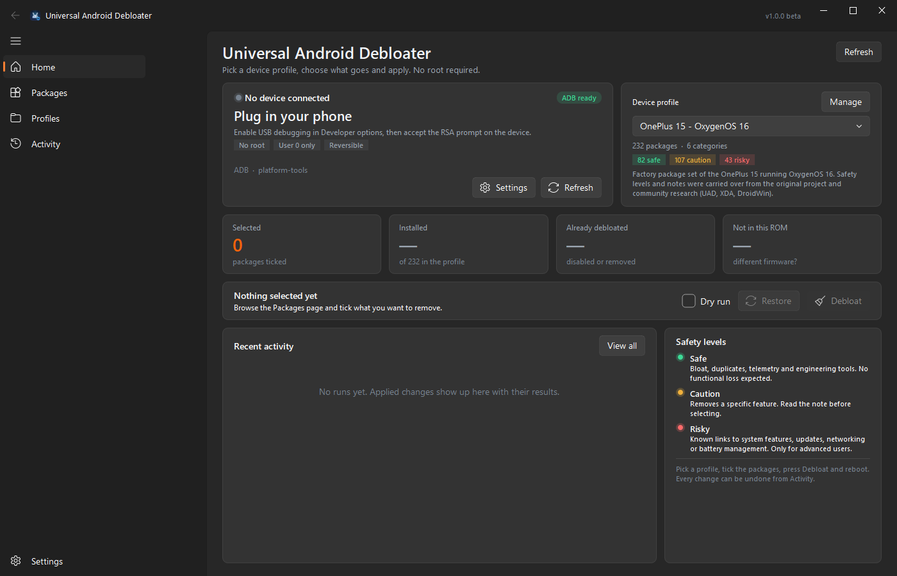

# Universal Android Debloater 1.0.0 beta

A portable Windows application that removes or freezes preinstalled Android bloat
over ADB — no root, no custom ROM, no command line. Pick a **device profile**, tick
what you do not need, apply, reboot. Everything stays reversible for user 0.


> **1.0.0 beta** — first public release. The core workflow is complete and tested;
> profiles for more phone families are welcome.



---

## Why profiles?

The original project was a PowerShell TUI hard-wired to the OnePlus 15 on
OxygenOS 16. Profiles turn that single device into a catalogue: every phone family
gets one JSON file with its packages, safety levels, descriptions and default
action. The debloater itself is generic — switch profiles when you switch phones,
keep several in the folder, or snapshot a connected device and start from there.

---

## Features

- **Device profiles** — all package data lives in `profiles/*.json`; add, import,
  export, duplicate or snapshot one from the connected phone.
- **Safety levels** — every package is `SAFE`, `CAUTION` or `RISKY`, with a note
  explaining what you lose.
- **Per-package action** — the profile default is `Disable` or `Uninstall`; click
  the action pill in the table to switch it for one package.
- **Live device state** — `Active`, `Disabled`, `Removed` or `Not on device`,
  read from `pm list packages` and refreshed after every run.
- **Filtering that scales** — search, category rail, safety filter and an
  “On device only” switch for a 232-package profile.
- **Apply / Restore / Dry run** — a dry run only prints the commands; restore
  enables frozen apps and reinstalls removed ones for user 0. A long batch can be
  stopped after the package that is currently being processed.
- **Undo the last run** — the Activity page can revert everything the previous
  debloat run changed, even after restarting the app.
- **Multi-device guard** — a device selector appears when more than one phone is
  connected; every command is bound to the selected serial.
- **ADB bootstrap** — installs Google Platform Tools through winget, or points at
  an existing `adb.exe` from Settings.
- **Fluent UI** — PySide6 + PySide6-Fluent-Widgets, Mica backdrop, Windows accent
  colour, instant dark/light switching, code-drawn icon.
- **Portable** — profiles and data live next to the launcher; copy the folder to a
  USB stick and your setup travels with it. No telemetry, no network calls except
  the optional pip/winget installs.

---

## Requirements

| | |
|---|---|
| OS | Windows 10 or 11 (Mica needs Windows 11) |
| Python | 3.10+ (developed on 3.15, 64-bit) |
| Phone | Android with **USB debugging** enabled, no root |
| ADB | Android SDK Platform Tools; the app offers a winget install |

---

## Quick start

1. Double-click **`Debloater.pyw`**. On a fresh Python installation it installs
   `PySide6` and `PySide6-Fluent-Widgets` with a small progress window, then starts.
2. Connect the phone and accept the **Allow USB debugging** prompt.
3. Pick the profile (the app suggests one when its `match` rules fit the phone).
4. Open **Packages**, use the category rail / search / safety filter and tick what
   you want gone.
5. Press **Debloat**, review the summary and confirm. Reboot the phone afterwards.
6. To bring something back, select it and press **Restore**, or use
   **Activity → Undo last debloat**.

Command line equivalent:

```powershell
python -m pip install -r requirements.txt
python Debloater.pyw
```

---

## Screens

| Packages | Profiles |
|---|---|
|  |  |

| Activity | Settings |
|---|---|
|  |  |

Light theme and the disconnected state:




---

## How it works

Every command runs as `adb -s <serial> shell …` and targets **user 0** only:

| Action | Command |
|---|---|
| Disable | `pm disable-user --user 0 <package>` |
| Uninstall | `pm uninstall --user 0 <package>` |
| Restore a frozen app | `pm enable --user 0 <package>` |
| Restore a removed app | `cmd package install-existing --user 0 <package>` |

The APK never leaves the system image, so both operations are reversible and do
not require root. A reboot is required before launchers and system UI reflect the
changes. Some OxygenOS packages refuse `disable-user` (the Oplus security layer
owns them); the run log shows the failure — switch that package to `Uninstall`.

Before a run the app reads three views from the phone:

```
pm list packages --user 0 -f      # installed (active + disabled)
pm list packages --user 0 -f -d   # disabled
pm list packages --user 0 -f -u   # every package known to user 0
```

which produces the four table states. The Apply summary is grouped by safety level
so a `RISKY` selection is hard to miss.

---

## Profiles

The bundled profile is **`profiles/oneplus15_oos16.json`** — 232 packages from a
OnePlus 15 on OxygenOS 16 (`BP2A.250605.015`), with 82 `SAFE`, 107 `CAUTION`,
43 `RISKY` entries.

- The **Profiles** page lists everything in `profiles/`, including files you drop
  in while the app is closed.
- **Import…** validates a JSON file and adds it under a free id.
- **Export…** copies the profile out; **Duplicate** is handy for making a variant
  without touching the original.
- **Create from device** reads **every package known to user 0** — active,
  disabled and already removed — records the observed state on each entry, and
  presets `Disable` for disabled apps / `Uninstall` for removed ones. Third-party
  apps are included by default; system packages are optional. The snapshot is a
  starting point: review levels and actions before applying it.
- The profile whose `match` rules fit the connected phone is suggested on the Home
  page; rules are plain regular expressions.

The full format, field by field, is documented in
**[docs/PROFILE_FORMAT.md](docs/PROFILE_FORMAT.md)**.

Validate every profile in the folder:

```powershell
python tools/validate_profiles.py
```

---

## Safety levels

| Level | Meaning |
|---|---|
| **SAFE** | Bloat, duplicates, telemetry, engineering tools. No functional loss expected. |
| **CAUTION** | You lose a specific feature — the table note says which one. Read it before toggling. |
| **RISKY** | Known or likely links to AOD, Live Alerts, networking, OTA updates or battery management. Advanced users only. |

Levels are judgement calls collected from Universal Android Debloater (UAD), XDA
threads, DroidWin and community reports. They are a guide, not a guarantee — you
can always restore.

---

## Activity, journal and logs

Each package command is written to `data/journal.jsonl` as it runs (append-only,
JSON Lines), so **Activity** shows history across restarts and can undo the last
debloat run. A human-readable log is written per run to:

```
data/logs/debloat_YYYYMMDD_HHMMSS_apply.txt
data/logs/debloat_YYYYMMDD_HHMMSS_revert.txt
```

The journal keeps the device serial, profile, action, result and ADB output.
Dry runs are journaled with `dryRun: true` and are ignored by undo.

---

## Data layout

```
profiles/                     bundled and user profiles (JSON)
data/selection/<profile>.json last checkbox/action state per profile
data/journal.jsonl            append-only run history
data/logs/                    one text log per run
data/crash.log                only written if startup fails
```

Delete `data/` to start with clean selections and history; delete a single
`data/selection/<profile>.json` to reset just that profile. The phone is not
touched by either operation.

---

## Project layout

```
Debloater.pyw                 double-click launcher + dependency bootstrap
debloater/
  app.py                      QApplication wiring, theme bootstrap
  paths.py                    portable folders, profile seeding
  core/
    models.py                 Level/Action/State, Package, Profile, matching
    profiles.py               ProfileStore (load/save/import/export/duplicate)
    adb.py                    ADB discovery, device props, package inventory, pm commands
    selection.py              per-profile selection + JSON persistence
    journal.py                JSONL run journal and run summaries
    engine.py                 sequential apply/revert executor with progress + log
    controller.py             application state, background threads, Qt signals
  ui/
    main_window.py            FluentWindow, navigation, live theme switching
    table.py                  package model, filter proxy, painted delegate
    widgets.py                cards, pills, stat tiles, safety bar, empty state
    dialogs.py                confirmations, profile name/snapshot dialogs
    theme.py                  Windows dark/light + accent + palette
    icon.py                   code-drawn application icon
    pages/                    Home, Packages, Profiles, Activity, Settings
profiles/                     device catalogues
tools/                        profile validation helper
tests/                        core + Qt tests, fake ADB, screenshot/stress harnesses
docs/                         profile format and screenshots
```

---

## Development

```powershell
python -m pip install -r requirements.txt

python Debloater.pyw                 # run
python -m unittest discover -s tests -p "test_*.py" -v

python tests/preview_ui.py           # screenshots of every page -> shots/
python tests/stress_ui.py            # page switching + theme flips + fake runs
```

`tests/fake_adb.py` implements the small ADB surface with a deterministic
OnePlus 15 simulation: 232 packages spread over active, disabled, removed and
absent states. The UI can therefore be developed and tested without a phone.

The code targets Python 3.10+ and uses only PySide6, PySide6-Fluent-Widgets and
the standard library.

---

## History

The project started as a PowerShell TUI for the OnePlus 15 on OxygenOS 16. Its
package table was carried over into `profiles/oneplus15_oos16.json`; the legacy
scripts are no longer part of this repository. Selections start fresh per profile
and are stored in `data/selection/`.

---

## Troubleshooting

| Symptom | Fix |
|---|---|
| “ADB not found” | Settings → **Install via winget**, **Auto-detect**, or **Browse…** for `adb.exe`. |
| “Waiting for authorisation” | Unlock the phone and accept the RSA fingerprint prompt; press Refresh. |
| Several devices listed | Use the device selector on Home — commands go to the selected serial only. |
| A package stays `Active` after Disable | The Oplus security layer refused it; set the action to **Uninstall** instead. |
| Nothing changed in the launcher | Reboot the phone — package state is applied at boot. |
| Profile not suggested | The `match` rules did not score 60 %; edit `match` or select it manually. |
| Restore fails for a package | It may not exist on this firmware (`Not on device`); the APK was never in the image. |

---

## Disclaimer

This tool changes package state on your phone. Everything is reversible for user 0
and no root is required, but use it at your own risk — keep a backup of anything
important and test on a device you can factory reset if necessary. The author is
not responsible for data loss or device issues.

UI patterns (Mica backdrop, Windows accent, code-drawn icon, Fluent pages) follow
the [Audio Desync Finder](https://github.com/Jank8/Audio-Desync-Finder) project.

---

## License

GNU General Public License v3.0 — see [LICENSE](LICENSE).

Copyright (C) 2026 Jank8.
